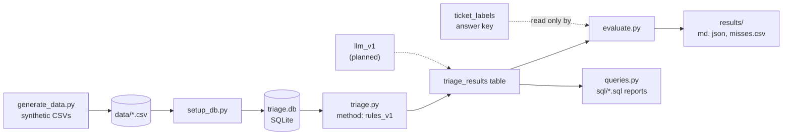

# Ticket Triage Baseline

A rule-based support-ticket triage system, built on SQLite and Python, with an evaluation harness that scores it against a hidden answer key. It is the **baseline** that any smarter method (an LLM, for example) has to beat to justify its cost and risk.

Built as the technical companion to the Shopify merchant support-ticket triage product case in my portfolio: [amershaik1.github.io/pm-fde-track](https://amershaik1.github.io/pm-fde-track/).

## The problem

Merchants send support tickets. Before anyone can help, each ticket needs two decisions: **which team should handle it** (category) and **how urgent is it** (priority). Doing this by hand is slow, and the costly mistake is an urgent ticket (payout stuck, store down, merchant locked out) sitting unseen in a general queue.

## What this project does

1. Stores merchants, tickets, an answer key, and triage results in a four-table SQLite database.
2. Triages every ticket with transparent keyword rules and flags the ones it cannot classify for a human.
3. Scores the result against the answer key: accuracy, urgent-ticket recall, coverage, and *where* it fails.
4. Provides six saved SQL reports a support lead could actually use.

The database stores results per `method`, so a future LLM-based triage can be scored with the identical harness and compared side by side.

## Results

Scored on the **112 held-out test tickets** (the 48 `dev` tickets are reserved for tuning future methods):

| Metric | `rules_v1` |
|---|---|
| Category accuracy | 74.1% |
| Priority accuracy | 72.3% |
| Urgent tickets caught (recall, of 22) | 77.3% |
| Urgent flags that were right (precision) | 70.8% |
| Coverage (handled without human review) | 67.0% |
| Accuracy on auto-routed tickets | 90.7% |

| Ticket type | Tickets | Category accuracy |
|---|---|---|
| Easy (standard wording) | 60 | 95.0% |
| Paraphrase (everyday wording) | 22 | 13.6% |
| Multi-topic | 15 | 53.3% |
| Vague | 15 | 100.0% |

Full breakdown: [`results/rules_v1_test.md`](results/rules_v1_test.md). Every mistake, with its text: [`results/rules_v1_test_misses.csv`](results/rules_v1_test_misses.csv).

### What the numbers say

- **The rules are excellent when merchants use standard vocabulary (95%) and nearly useless when they do not (13.6%).** Real merchants write "the money from last week still hasn't shown up", not "payout delayed".
- **Most failures are honest ones.** Of the 29 wrong categories, 22 were flagged for human review. The system said "I don't know" instead of guessing.
- **The dangerous failures are silent ones.** The other 7 were confidently misrouted, and all 7 were multi-topic tickets where two keyword lists collided (a "shipping labels" feature request routed to Shipping). An LLM should be judged hardest on this tier.
- **No urgent ticket was lost silently.** All 5 missed urgent tickets landed in the review queue. But they sit there marked `medium`, so the queue is not ordered by real urgency. That is a concrete product gap.
- **Priority is the weakest part (72.3%)** because urgency is judged by a handful of crude words.

## Architecture



The data model and design notes are in [`docs/architecture.md`](docs/architecture.md).

## Quick start

Requires Python 3.10 or newer. No packages to install.

```
git clone https://github.com/AmerShaik1/pm-fde-track.git
cd pm-fde-track/ticket-triage-baseline

python src/setup_db.py       # build the database from data/*.csv
python src/triage.py         # run the rule-based triage
python src/evaluate.py       # score it on the test split
python src/queries.py        # run the saved SQL reports
```

On macOS or Linux, use `python3` instead of `python`. The CSVs are committed, so `generate_data.py` is optional; it recreates them identically (fixed random seed).

Useful variations:

```
python src/evaluate.py --split all
python src/queries.py review_queue
python src/queries.py tickets_for_merchant --merchant 2
```

## Project structure

```
ticket-triage-baseline/
  data/        synthetic merchants, tickets, and answer key (no real customer data)
  src/         generate_data.py, setup_db.py, triage.py, evaluate.py, queries.py, db.py
  sql/         six saved reports, one .sql file each
  results/     scores, per-method metrics (json), and every mistake (csv)
  docs/        architecture and data model
  DECISIONS.md why it was built this way
```

## Key decisions

Full reasoning in [`DECISIONS.md`](DECISIONS.md). In short: rules before AI, an answer key kept separate from the system being tested, a held-out test split, results stored per method, and a "flag for review" path instead of forced guesses.

## Limitations

- **The data is synthetic and was written by one author.** The dataset and the rules were both written by me, which tends to make rules look better than they would on real tickets. Treat the numbers as a measurement of this pipeline, not a forecast of production accuracy.
- **The paraphrase tier is deliberately hard.** Those tickets were written to avoid standard vocabulary, so 13.6% shows the tier works as a stress test, not how common such tickets are in the real world.
- **The data is small** (160 tickets, 112 in the test split) and built from a limited set of ticket templates, so small differences between methods will not be meaningful.
- **Rules are English-only** and have no handling for typos, long threads, or attachments.
- **Weekly volume and merchant rankings in the SQL reports are artifacts of random generation**, not findings.

## What's next

Build `llm_v1`: classify the same tickets with an LLM, store results with `method = 'llm_v1'`, tune the prompt only on the `dev` split, and score it on `test` with the same `evaluate.py`. The questions to answer with real numbers: does it fix the paraphrase tier, does it handle multi-topic tickets better than keyword collisions do, and what does it cost per ticket compared with a rule that costs nothing?
