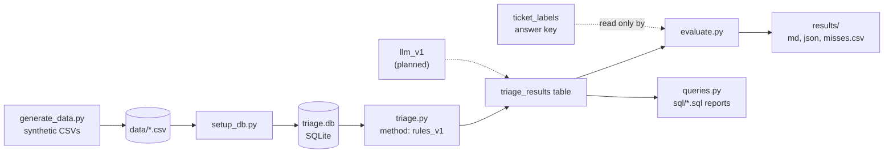
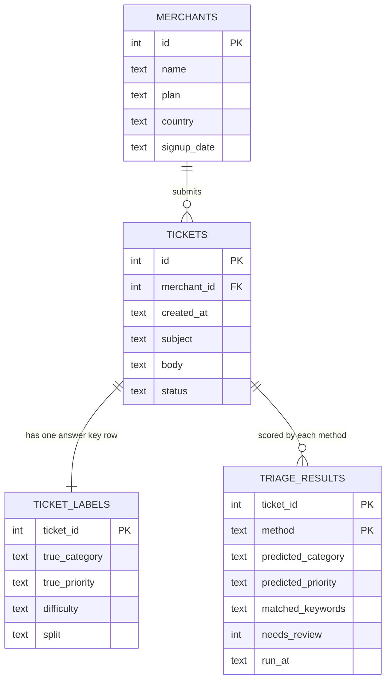

# Architecture and data model

## How a ticket moves through the system

| Stage | File | What it does |
|---|---|---|
| Data | `generate_data.py` | Creates fake merchants and tickets with a fixed random seed, so the data is reproducible. |
| Load | `setup_db.py` | Builds the SQLite database from the CSVs. Safe to re-run; it rebuilds from scratch. |
| Triage | `triage.py` | Scores each ticket against keyword lists, picks a category and priority, flags unknowns for review. |
| Evaluate | `evaluate.py` | Compares predictions with the answer key and reports where the method fails. |
| Report | `queries.py` + `sql/` | Runs saved SQL reports for a support lead. |

## Data model

## Why the tables are shaped this way

- **`ticket_labels` is separate from `tickets`.** The triage code never reads the answer key. Only `evaluate.py` does. Keeping them apart makes it impossible for a method to "cheat" by accident.
- **`triage_results` is keyed on (ticket, method).** Several methods can store results for the same ticket, so `rules_v1` and a later `llm_v1` can be compared fairly on identical tickets.
- **`needs_review` is a column, not a category.** "I could not classify this" is a different statement from "this is about nothing", and the review queue report depends on that difference.
- **`split` is stored on the label.** The `dev` tickets can be used to tune a method; the `test` tickets stay untouched so the final score is honest.

## Where this would change in production

- SQLite becomes a hosted database such as Postgres, with tickets arriving from the helpdesk API instead of CSV files.
- `triage.py` becomes a service called when a ticket is created, writing the result back to the helpdesk as tags.
- `evaluate.py` runs on a schedule against a sample of human-reviewed tickets, to catch accuracy drifting as merchant language changes.
